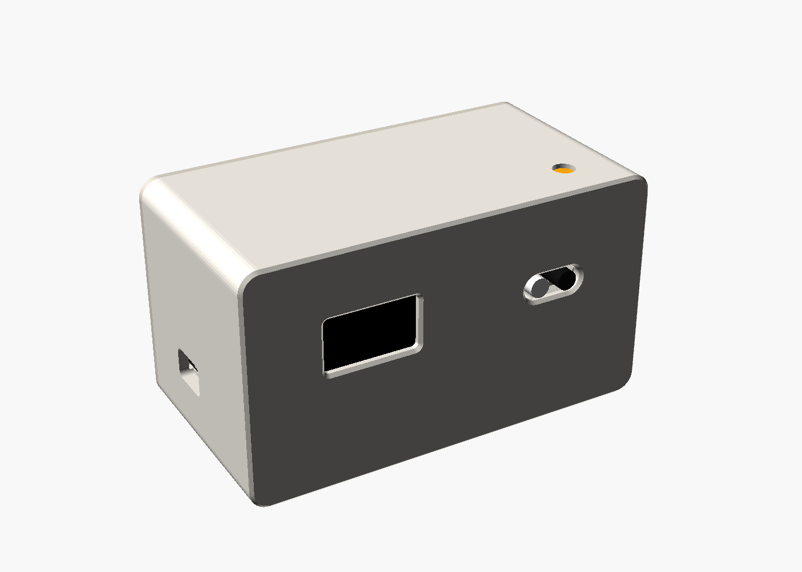

# ESP32 Clock

นาฬิกาตั้งโต๊ะ ESP32 + จอ OLED พร้อมเซนเซอร์แสง อุณหภูมิ/ความชื้น และควบคุมด้วยการโบกมือ (IR) — มีไฟล์กล่องสำหรับพิมพ์ 3D



## อุปกรณ์

| อุปกรณ์ | หน้าที่ |
|---|---|
| ESP32 DevKit (30 ขา) | ตัวควบคุม + WiFi |
| OLED 0.96" I2C (SSD1306) | จอแสดงผล |
| DS3231 | นาฬิกาเวลาจริง (เดินต่อแม้ถอดไฟ) |
| FC-51 IR | ควบคุมด้วยการโบกมือ |
| LDR module | ปรับความสว่างจอ / ดับจอตอนมืด |
| DHT11 module | อุณหภูมิ + ความชื้น |

## การต่อสาย

| อุปกรณ์ | ขา | ESP32 |
|---|---|---|
| OLED / DS3231 | SDA | GPIO 21 |
| OLED / DS3231 | SCL (SCK) | GPIO 22 |
| OLED / DS3231 | VCC / GND | 3V3 / GND |
| LDR | AO | GPIO 34 |
| IR | OUT | GPIO 27 |
| DHT11 | DATA | GPIO 4 |
| (ปุ่ม BOOT บนบอร์ด) | — | GPIO 0 ใช้แทนการโบกมือได้ |

## ติดตั้งโค้ด

ไลบรารี (Arduino Library Manager): `Adafruit SSD1306`, `Adafruit GFX Library`, `RTClib`, `DHT sensor library`, `Adafruit Unified Sensor`

บอร์ด: **ESP32 Dev Module** — เปิด `firmware/ESP32_Clock/ESP32_Clock.ino` แล้วอัปโหลด

```bash
arduino-cli compile --upload -p /dev/cu.usbserial-0001 --fqbn esp32:esp32:esp32 firmware/ESP32_Clock
```

## การควบคุม (โบกมือที่ IR หรือกดปุ่ม BOOT)

| ท่า | ผล |
|---|---|
| โบกสั้น | ถัดไป / +1 |
| ค้างมือ 0.7 วิ | ตกลง / เริ่ม-หยุด (ทำงานทันที) |
| ค้างต่อจนครบ 3 วิ | รีเซ็ต (หน้าจับเวลา/นับถอยหลัง) |

หน้าจอ: นาฬิกา → อุณหภูมิ/ความชื้น → จับเวลา → นับถอยหลัง — ค้างมือที่หน้านาฬิกาเพื่อเข้าเมนูตั้งค่า

## WiFi และการตั้งค่าผ่านมือถือ

- ยังไม่ได้ตั้ง WiFi หรือต่อ WiFi บ้านไม่ได้ภายใน 30 วิ → นาฬิกาเปิด WiFi **`ESP32-Clock`** (รหัส `12345678`) ให้เอง
- ต่อมือถือแล้วเปิด `http://192.168.4.1` → ตั้งเวลาจากมือถือ, ใส่ WiFi บ้าน (2.4 GHz), ตั้งค่าอื่นๆ
- ต่อ WiFi บ้านได้แล้ว นาฬิกาจะดึงเวลาจาก NTP เองทุกชั่วโมง ถ้าเน็ตหลุดก็เดินต่อจาก DS3231

## กล่อง (3D print)

| ไฟล์ | วางพิมพ์ |
|---|---|
| `body_print.stl` | ด้านหน้าคว่ำลงฐาน ไม่ต้องใช้ support |
| `cover_print.stl` | ด้านนอกคว่ำลง |
| `clock_case.scad` | ต้นฉบับ OpenSCAD (แก้ขนาดได้ที่ส่วนบนของไฟล์) |

น็อต: M3×10 เกลียวปล่อย 4 ตัว — ขนาดภายนอก 104.8 × 58.8 × 56.5 มม.
